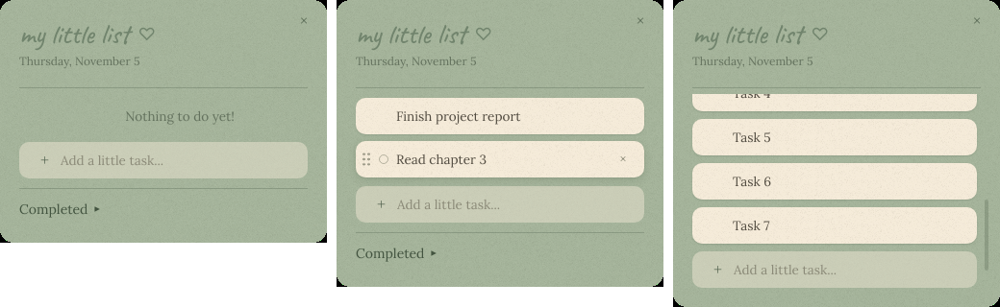
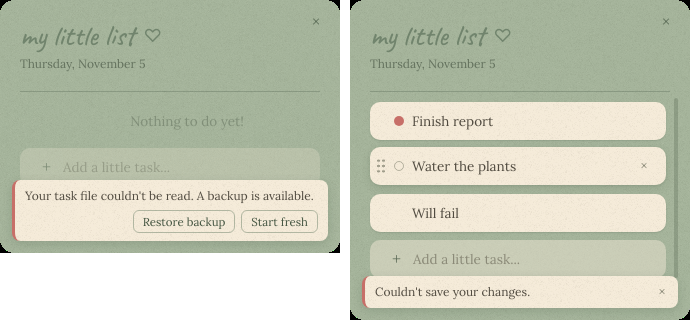
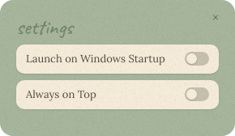

# Morrow

A small to-do widget for the Windows desktop with a vintage botanical look. Morrow lives on the desktop and in the system tray, works fully offline and keeps tasks in a local JSON file with automatic backups.

Built with **Electron and plain HTML, CSS and JavaScript** — no front-end framework.

> 🚧 **Early version (v0.1.0).** The planned MVP features are implemented and covered by tests, but there is no published release or installer download yet. Docs in `docs/` are in Turkish.

<p>
  
</p>
<p>
  
  
</p>

## Features

**Tasks**
- Add, edit (double-click), delete and complete tasks; restore completed tasks to their old position
- Priorities (high / medium / low / none) with colored dots
- Drag-and-drop reordering
- A collapsible *Completed* section showing the five most recently completed tasks

**Widget**
- Frameless 340 px wide window whose height adapts to the content (120–320 px)
- Remembers its position; opens centered if the saved position is off-screen
- System tray icon with Open / Settings / Quit; closing the widget only hides it
- Settings: *Always on Top* and *Launch on Windows Startup*, applied instantly
- Single instance: opening Morrow again shows the existing widget

**Data safety**
- Tasks are saved to `%APPDATA%\Morrow\tasks.json` with atomic writes
- A backup of the last valid file is kept before every save
- If the file is corrupt, the list is locked and the user can **restore the backup** or **start fresh**; the corrupt file is never deleted

**Security**
- `contextIsolation`, `sandbox` and no `nodeIntegration` in the renderer
- A narrow preload API; IPC handlers check which window sent the message
- Content Security Policy that only allows local resources (fonts are bundled, no network access)

## Tech Stack

- Electron 31
- HTML, CSS, vanilla JavaScript
- Vitest (unit tests), Playwright (end-to-end tests with Electron)
- electron-builder (Windows NSIS installer)

## Getting Started

Requires Node.js 20+ on Windows.

```bash
npm install
npm start
```

### Tests

```bash
npm test           # 34 unit tests (Vitest)
npm run test:e2e   # 10 end-to-end tests (Playwright + Electron)
```

End-to-end tests use a temporary data folder and simulate the startup setting, so they don't touch your real tasks or Windows settings.

### Build an installer

```bash
npm run build      # creates dist/Morrow-Setup-<version>.exe
```

The installer is not code-signed, so Windows SmartScreen may show a warning.

## How It Was Planned

The app was built in phases from written specifications:

| Document | Contents |
|---|---|
| `docs/PRD.md` | Product requirements and user stories |
| `docs/TRD.md` | Technical requirements |
| `docs/UI_SPEC.md` | Visual design specification |
| `docs/APP_FLOW.md` | User flows and edge cases |
| `docs/PROJECT_STRUCTURE.md` | Folder and module layout |
| `docs/IMPLEMENTATION_PLAN.md` | Development phases |
| `docs/DECISIONS.md` | 38 recorded decisions where the documents conflicted or were open |

## Known Limitations

- Windows only (tray, startup and installer are set up for Windows)
- No published release yet; the installer has to be built locally
- No code signing and no auto-update
- No sync between devices — tasks are stored only on the local machine
- English interface only

## Author

Mina Özcan – [GitHub](https://github.com/minaozcn) · [LinkedIn](https://www.linkedin.com/in/mina-ozcan/)
